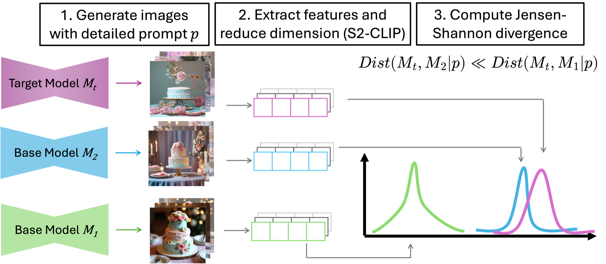

# Identifying Provenance of Generative Text-to-Image Models

**USENIX Security 2026**

[](https://www.usenix.org/conference/usenixsecurity26/presentation/ha)
[](https://huggingface.co/datasets/lemonjellybelly/model-provenance-features)

[Quick start](#quick-start-cpu-only) · [Citation](#citation)



Given a text-to-image model, can we determine whether the model was trained from scratch or fine-tuned from a known base model? We generate images from every model with the same prompt, embed them with S2-CLIP, and measure a
distance between the models' feature distributions. The base model closest to the target is its predicted provenance.

This repository contains the full pipeline and the S2-CLIP features we computed for 8 base models
(SD2.1, SDXL, DeepFloyd IF, FLUX, Hunyuan-DiT, Kolors, PixArt-Σ, Sana) on the *sofa* prompt,
plus one fine-tuned SD2.1 model. With the released features, you can reproduce the distances on a CPU in minutes.

## Overview

```
 prompt
   │
   ▼  [1] generate_images.py      text-to-image model  →  3,000 images per model
 images/<prompt>/<model>/*.png
   │
   ▼  [2] extract_features.py     S2-CLIP →  one 76,800-d vector per image
 features/<prompt>/<model>.pt     ◄── released on Hugging Face
   │
   ▼  [3] compute_distances.py    per trial: Isomap → Gaussian per model → geometric Jensen-Shannon divergence
 results/<prompt>/summary.csv     closest base model = predicted provenance
```

```
├── generate_images.py      # step 1
├── extract_features.py     # step 2
├── compute_distances.py    # step 3
├── provenance/
│   ├── models.py           # the 8 base models and their sampling settings
│   ├── features.py         # S2-CLIP feature extractor
│   └── distance.py         # Isomap + Gaussian fit + geometric JS divergence
├── scripts/                # the exact commands used in the paper
├── configs/
│   └── prompts.json        # prompts (keys are passed as --prompt)
└── features/               # released S2-CLIP features, downloaded from Hugging Face
    └── sofa/<model>.pt
```

## Installation

```bash
git clone https://github.com/annayjha/Model-Provenance.git
cd Model-Provenance

pyenv install 3.10.12
pyenv virtualenv 3.10.12 provenance
pyenv local provenance    # activates the env automatically inside this folder
pip install -r requirements.txt
```

This uses [pyenv](https://github.com/pyenv/pyenv) with the [pyenv-virtualenv](https://github.com/pyenv/pyenv-virtualenv) plugin
(`brew install pyenv pyenv-virtualenv` on macOS).

S2-CLIP features use [Scaling on Scales](https://github.com/bfshi/scaling_on_scales) with
[CLIP](https://huggingface.co/openai/clip-vit-base-patch32). Images are generated with 🤗 [Diffusers](https://github.com/huggingface/diffusers).
The features are hosted on [Hugging Face](https://huggingface.co/datasets/lemonjellybelly/model-provenance-features)
(~0.9 GB per model, ~8.3 GB in total). Download them into `features/`:

```bash
bash scripts/download_features.sh sofa
```

## Quick start (CPU only)

Compute the distances between the 8 base models and the fine-tuned SD2.1 using the released sofa features:

```bash
bash scripts/compute_distances.sh sofa
```

This writes `results/sofa/distances_per_trial.csv` and `results/sofa/summary.csv`, and prints each target model's
distance to every base model (~3 minutes on a 16 GB laptop; the features alone take ~8.3 GB of RAM,
so close other memory-heavy apps, and lower `--num_workers` if the run stalls at `trials: 0%`):

```
Distance from ft-sd21-pcb-100k to each base model (closest = predicted provenance):
  sd21            0.416 +- 0.087
  hunyuan         3.177 +- 0.593
  sdxl            3.340 +- 0.569
  deepfloyd       3.681 +- 0.637
  kolors          4.129 +- 0.438
  flux            4.151 +- 0.684
  sana            6.178 +- 0.854
  pixartsigma     6.251 +- 1.085
```

`--targets` and `--base_models` choose which models to compare.

## Released features

```markdown
The code is released under the [GNU GPL v3.0](LICENSE). The released features are under CC BY 4.0.
```

| Prompt   | Models                                                                            | Images / model |
| -------- | --------------------------------------------------------------------------------- | -------------- |
| `sofa` | sd21, sdxl, deepfloyd, flux, hunyuan, kolors, pixartsigma, sana, ft-sd21-pcb-100k | 3,000          |

Prompts are in [`configs/prompts.json`](configs/prompts.json). Each `.pt` file is a list of
`{image_filename: feature}` dicts (one per GPU process), where each feature is a 76,800-d float32 tensor and the
filename is the image's generation seed. To load a file as an `(n_images, 76800)` array:

```python
from provenance.distance import load_features
features = load_features("features/sofa/sd21.pt")
```

## Full pipeline

Steps 1 and 2 need GPUs and are parallelized with 🤗 Accelerate. Set `NUM_GPUS` in the scripts to match your machine.

### Step 1: generate images

```bash
bash scripts/generate_images.sh sofa      # all models, with the seeds used in the paper
```

or a single model:

```bash
accelerate launch --num_processes=4 generate_images.py \
    --model sdxl --prompt sofa --initial_seed 20934857 --n 3000 --output_dir images/sofa/sdxl
```

All models use a guidance scale of 10 and 50 denoising steps, except DeepFloyd IF, which uses the diffusers
default number of steps for each stage (100 for stage I, 50 for stage II):

| `--model`     | Default checkpoint                                                                 | Resolution |
| --------------- | ---------------------------------------------------------------------------------- | ---------- |
| `sd21`        | `stabilityai/stable-diffusion-2-1`                                               | 768        |
| `sdxl`        | `stabilityai/stable-diffusion-xl-base-1.0` (+ `madebyollin/sdxl-vae-fp16-fix`) | 1024       |
| `deepfloyd`   | `DeepFloyd/IF-I-XL-v1.0` → `DeepFloyd/IF-II-L-v1.0`                           | 256        |
| `flux`        | `black-forest-labs/FLUX.1-dev`                                                   | 1024       |
| `hunyuan`     | `Tencent-Hunyuan/HunyuanDiT-v1.2-Diffusers`                                      | 1024       |
| `kolors`      | `Kwai-Kolors/Kolors-diffusers`                                                   | 1024       |
| `pixartsigma` | `PixArt-alpha/PixArt-Sigma-XL-2-1024-MS`                                         | 1024       |
| `sana`        | `Efficient-Large-Model/Sana_1600M_1024px_diffusers`                              | 1024       |

FLUX.1-dev and DeepFloyd IF are gated on Hugging Face: accept their licenses and run `huggingface-cli login` first.
Use `--checkpoint` to sample from different weights with the same settings, e.g. your own fine-tuned SD2.1.

### Step 2: extract S2-CLIP features

```bash
bash scripts/extract_features.sh sofa     # images/sofa/<model>/ → features/sofa/<model>.pt
```

### Step 3: compute distances

```bash
bash scripts/compute_distances.sh sofa
```

| Hyperparameter                 | Value                                          | Flag               |
| ------------------------------ | ---------------------------------------------- | ------------------ |
| Trials                         | 30                                             | `--n_trials`     |
| Images per model per trial (k) | 100                                            | `--n_samples`    |
| Isomap dimensions              | 10, 20, 30                                    | `--n_components` |
| Isomap neighbors               | 5 (scikit-learn default)                       |                    |
| Divergence                     | geometric Jensen-Shannon, α = 0.5, log base 2 |                    |

Each trial uses a disjoint set of images, so `n_trials × n_samples` must not exceed the number of images per model.
Isomap is fit only on the base models; target models are projected into the same space.

**Outputs.** `distances_per_trial.csv` has one row per `(trial, model_1, model_2, distance)`.
`summary.csv` has the `mean` and `std` of each pair's distance over trials, sorted from closest to farthest.

## Testing your own model

```bash
# 1. generate images with the same prompt
accelerate launch --num_processes=4 generate_images.py --model sd21 --checkpoint /path/to/my-model \
    --prompt sofa --initial_seed 1234 --n 3000 --output_dir images/sofa/my-model
# 2. extract features (models that already have a .pt are skipped)
accelerate launch --num_processes=4 extract_features.py --image_dir images/sofa --output_dir features/sofa
# 3. compare against the released base model features
python compute_distances.py --features_dir features/sofa --output_dir results/my-model --targets my-model
```

## Citation

```bibtex
@inproceedings {317927,
author = {Anna Yoo Jeong Ha and Wenxin Ding and Stanley Wu and Shawn Shan and Haitao Zheng and Ben Y. Zhao},
title = {Identifying Provenance of Generative {Text-to-Image} Models},
booktitle = {35th USENIX Security Symposium (USENIX Security 26)},
year = {2026},
isbn = {978-1-939133-58-8},
address = {Baltimore, MD},
pages = {4503--4522},
url = {https://www.usenix.org/conference/usenixsecurity26/presentation/ha},
publisher = {USENIX Association},
month = aug
}
```
